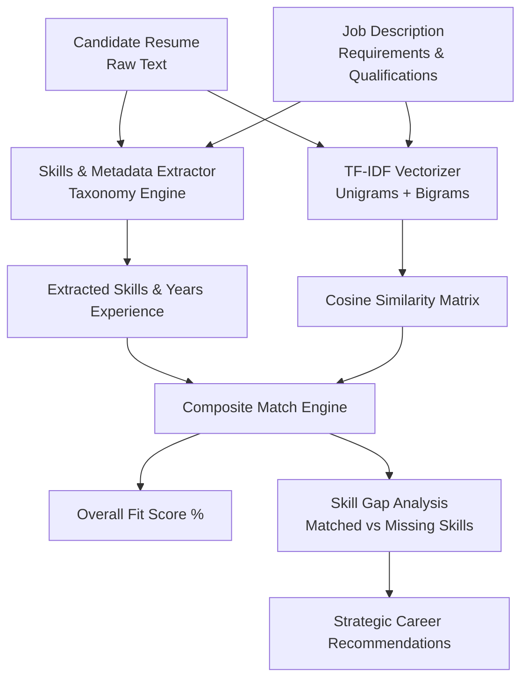

# AI Resume Matcher

[](https://www.python.org/downloads/)
[](https://opensource.org/licenses/MIT)
[](https://docs.pytest.org/)
[](https://scikit-learn.org/)
[](https://github.com/piyush1008-cyber/ai-resume-matcher)

> **Automated NLP candidate resume parsing and Job Description (JD) matching engine in Python.** Computes TF-IDF n-gram semantic similarity, skill overlap percentages, experience alignment, and generates targeted skill gap upskilling recommendations.

---

## Architecture & Algorithm



### Mathematical Scoring Formulation

$$\text{Composite Score} = 0.45 \cdot S_{\text{skills}} + 0.35 \cdot S_{\text{semantic}} + 0.20 \cdot S_{\text{experience}}$$

Where:
- $S_{\text{skills}} = \frac{|\text{Resume Skills} \cap \text{JD Skills}|}{|\text{JD Skills}|}$
- $S_{\text{semantic}} = \cos(\mathbf{v}_{\text{resume}}, \mathbf{v}_{\text{jd}}) = \frac{\mathbf{v}_{\text{resume}} \cdot \mathbf{v}_{\text{jd}}}{\|\mathbf{v}_{\text{resume}}\| \|\mathbf{v}_{\text{jd}}\|}$
- $S_{\text{experience}} = \min\left(1.0, \frac{\text{Candidate Years}}{\text{Required Years}}\right)$

---

## Key Features

- **Extensive Skills Taxonomy:** Scans for 150+ technology keywords across Languages, Backend Frameworks, Databases, Cloud/DevOps, and Machine Learning.
- **Semantic Text Matching:** Uses TF-IDF sublinear scaling with unigram and bigram tokenization to evaluate contextual similarity.
- **Skill Gap Detection:** Instantly isolates missing competencies required by the recruiter.
- **Actionable Career Advice:** Generates personalized recommendations on what projects or skills to build next.
- **JSON Export:** Full support for programmatic integration into HR portals and ATS tracking systems.

---

## Quickstart & Usage

### 1. Run Automated Demonstration
```bash
python main.py demo
```
Matches a real-world software engineering resume against both a **Backend Developer JD** and a **Machine Learning Engineer JD**, outputting detailed fit analytics.

### 2. Match Custom Resume Against Job Description
```bash
python main.py match --resume samples/backend_resume.txt --jd samples/senior_backend_jd.txt --json match_output.json
```

### 3. Extract Skills and Profile Metadata
```bash
python main.py skills --file samples/backend_resume.txt
```

---

## Running the Test Suite

```bash
pytest -v
```

All tests for skill extraction, years of experience parsing, TF-IDF cosine similarity, and skill gap detection pass cleanly.

---

## Author & License

- **Author:** Piyush Kangle ([@piyush1008-cyber](https://github.com/piyush1008-cyber))
- **Email:** piyushkangle@gmail.com
- **License:** [MIT License](LICENSE)
